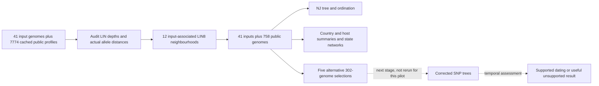

# Current progress

The current status is maintained in the [acceptance checklist](ACCEPTANCE_PLAN.md)
and [worked example](WORKED_EXAMPLE.md). The chronological entries below are
historical and their pending-work statements are not the current task list.

# Historical local beta progress

18 October 2026. This is a working local beta, not a release certification.
The [acceptance matrix](ACCEPTANCE_PLAN.md) records remaining work and evidence.
No changes in this work have been published to GitHub.

## Current checkpoint

The current V7 frozen software passed 1,169 tests (two skipped), Ruff and strict
docs. A fresh external V7 wheel completed the supplied eight-genome
prepare/cgMLST/GrapeTree export route outside the checkout, with exact sample
identities preserved and no broken references in the 13-page asset audit. This
pretyped route does not establish clean-assembly native-tool installation.
Exact accession searches retain their complete identity evidence.
V4 live context recovery and the difficult-query typing audits are terminal;
their scoped results are recorded below and in the acceptance matrix.

The main report now distinguishes search, context, analysis and display scopes
and adds one LIN-relationship column to nearest neighbours. The refreshed
725-genome report preserves all 73 original files and 41 copied raw-evidence
files; distances, tree, coordinates, selections and date diagnostics are unchanged.
81 affected tests passed, followed by the V6 full suite: 1,152 passed, two skipped
in 325.41 seconds. Ruff and strict docs passed. A fresh external V6 wheel also
passed the exact eight-genome prepare/cgMLST/GrapeTree route.

The Linux/AMD64 container installed the frozen environment and passed native-tool
preflight and prepare. It stalled in Matplotlib tick calculation; an independent
NumPy scalar floor division also timed out under Rosetta. The owned run was
stopped, evidence retained and container removal confirmed. That AMD64 run did not complete. A separate native Linux ARM64 container has now
completed prepare, cgMLST, tree and time on the exact eight-genome fixture.
All four ordinary commands exited zero; the 100-permutation temporal screen
returned unsupported (p=0.376), so time correctly withheld a dated tree.
The container was removed and immutable inputs retained their hashes.
Independent artifact and portable-loader review passed, including loading a
relocated copy of the dataset, tree and time result. This does not
satisfy the Linux x86_64 or physical HPC/SLURM gate.

A separate frozen V7 Linux ARM64 run completed the same supplied pretyped
eight-genome fixture. Environment installation, preflight and all four ordinary
stage commands exited zero. Independent terminal review confirmed exact sample
and assembly identities, source/archive/check/fixture/lock pins, Linux aarch64
runtime and import origin, 100 tree randomisations, unsupported time output
(p=0.376) without override, bounded resource use and owned-container removal.
The run took 199.05 seconds; sampled container memory peaked at 2.52 GB. This is
a package/workflow check, not new-assembly typing or Linux x86_64, physical Linux,
HPC or SLURM acceptance. See
`validation/beta/linux-aarch64-acceptance-v7-independent-review/terminal-review-v7.json`
and `tmp/beta-linux-aarch64-v7-20261018T032506Z/launcher-evidence.json`.

Ordinary native preparation of all 101 exact published assemblies completed
(exit 0, 943.61 seconds, 3.70 GB sampled process-family peak). The wrapper retained
an exit-1 postflight check: only the SQLite shared-memory file modification time
changed; every pinned content hash and size still matched. A separate adapter
then caught a production provenance defect before making any outputs: merging
the native LIN result cleared supplied source genome UUIDs. Accessions, BioSamples,
ST and exact assembly hashes remain intact. The defect is fixed at the native assignment/import boundary. Ordinary frozen-call
preparation restores all 101 UUIDs with unchanged calls and original files; two fresh
native calls also retain their UUIDs and match the prior scientific calls. The original
results and failures remain preserved. The V7 source passed 1,169 tests (two skipped), Ruff and strict docs.
Ordinary import retained 97 ST258 records; unchanged LIN5 partitioning analyses 95
with 12 inputs and 83 comparisons, explicitly retaining two unmatched contexts
in the prepared dataset. Two ordinary cgMLST runs produced the same five distinct
63-tip selections. All 13 required tips and nearest boundary ties are retained;
40 requested contexts expanded to 51 to retain requirements and the 12-member
representative reserve. The strict five-tree/time sensitivity run is now active
with 100 permutations per tree and no dating override. Selection 001 completed
its strict SNP tree and passed the temporal screen (100 successful randomisations,
p=1/101, R²=0.39). Its ordinary time command completed without an override;
the separate execution receipt confirms 63 selected identities and unchanged
source and source tree. Independent review passed for this first result: all 61 nontrivial rooted
clades were preserved, and the saved conditional TreeTime intervals reconcile.
The other four runs remain pending, so this is not evidence of
between-selection date stability. See
`validation/beta/positive-subsampling-plan/first-time-execution-v7/result.json`.

Targeted browser checks of the current 725-genome report confirmed labelled form
controls, named frames and navigation, a working embedded full-size figure dialog
with Escape/focus return, and no document overflow at 390 pixels. This is not a
screen-reader audit, a direct file-protocol test or a human walkthrough. See
`validation/beta/report-navigation-accessibility-v6.json`.

The sections below retain earlier chronological evidence and the limitations
known at each stage. Their pending-work descriptions are historical; use the
current acceptance matrix for outstanding work.

## Historical V2 native context acceptance

The normal CLI completed a replay of the captured 13,421-record ST258 public
source under the corrected Pasteur reference. It genuinely reassigned all public
profiles before LIN8 refinement and produced a report with three input genomes
and 717 public comparisons. The CLI took 898.49 seconds; sampled peak process-family
memory was 6.80 GiB and allocated output reached 1.78 GiB. No context assemblies
were requested. This reuses the recorded source snapshot, not a fresh provider
catalogue. See `validation/beta/native-wholest-published-replay.json`.

The source and runtime stayed identical to freeze v2 throughout that execution;
all 637 original reference files also retained their bytes and modification
times. The freeze was released only after those checks, so subsequent fixes have
separate provenance.

An independent distance audit found a selection defect: one Greek accession
unit tied at zero differences was excluded because the provider rejected any
provisional LIN assignment. Its requested LIN8 prefix was known; only deeper
components were unresolved. The conservative-prefix correction is now applied and passed the affected checks;
fresh ordinary CLI acceptance is still pending. The completed v2 run therefore
establishes throughput and retained-pool calculations,
but does not pass the whole-ST nearest-neighbour retention requirement.

Raw export checkpoints and clearer assignment progress have now been applied;
108 focused checks passed. The shared country/host selector is also reused by
tree and time reports, with 66 affected checks passing and one skipped. Host
controls are omitted without usable metadata. Browser visual acceptance of these
new panels remains unverified. Reference-content binding is applied, with 155 focused checks passing; real
interruption recovery remains to be exercised; none of these engineering results validates a
biological cluster cutoff.

## What the current ST258 demonstration actually runs

Open the retained local pilot at
`tmp/beta-st258-relatedness/cgmlst/profile_report.html`.
It retains every one of the original 842 nearest input–public pairs and all
211 mandatory public neighbours. The five selections retain the inputs and
mandatory neighbours while varying optional representatives.

This is a declared narrower analysis, not just a display filter. Its NJ tree,
ordination and state network are recalculated on the 799-genome pool. The
original 7,815-genome run remains intact. The existing report style and shared
interactive components are retained. Browser review verified the displayed
counts, readable accession lookup and tip metadata; it does not establish
biological validity.

## What the grouping evidence means

The broad background is useful for discovery but is not a close-relative cluster.
LIN8 is a promising descriptive neighbourhood for this ST258 example. It is not
an outbreak definition: observed within-prefix pairwise differences reach 13
alleles, and some nearest neighbours cross an input's own prefix. The report must
continue to use measured differences, called-locus coverage and all ties when
identifying nearest relatives. See the [grouping audit](ST258_GROUPING_AUDIT.md).

Automatic resolution selection remains open. The pilot does not change the
production default, prove a universal allele cutoff, or establish a time-based
cutoff. Reference-snapshot and full-code/profile discrepancies require further
checking.

## Completed engineering checks

- Date-fitting output no longer repeats complete allele profiles/provider records
  in every regression point. The large ST258 diagnostic fell from 783.6 MB to
  20.4 MB, with unchanged numerical fits and source tree.
- Shared prepare/tree/time output guides explain saved results and next commands.
- The export command produces checked local GrapeTree and Microreact files.
  Both target viewers were exercised on the small synthetic fixture.
- A fresh Apple Silicon Python environment installed the wheel and ran
  prepare, cgMLST and export without source-path imports or developer repairs.
  This does not cover installation of the native tool stack.
- Reference readiness rejects empty or malformed caller indexes and incompatible
  locus order. Native biological typing concordance still requires ready,
  compatible reference databases and exact matched assemblies.

## Remaining release gates

Independent published benchmark runs, optional branch support and a clean macOS
Python-wheel workflow now have scoped evidence, summarised below. Complete clean
native installations, Linux and real SLURM execution, automatic neighbourhood
policy, new-assembly E. coli HierCC assignment/reference validation and two
independent human walkthroughs remain open. A one-record provider HClink import
has passed; it does not establish a reusable reference or native assignment.
Negative or unsupported temporal results are valid outcomes; a favourable
regression is not a release criterion.

## Pasteur follow-up

The Klebsiella references are now installed and ready: 629 loci, version
2026-10-05. Eight exact assemblies completed native typing with matching cgLIN
codes and no unexplained shared-locus differences after resolving 14 older novel
allele hashes to their identical numbered sequences. Historical provider scope
and reference provenance remain incomplete; this is partial concordance evidence.
E. coli/HierCC reference validation remains separate. The reusable
`authorize-pasteur` command handles one-time consent without account passwords.

## Active-goal follow-up

The full beta specification is now the active delivery goal, in the sequence
recorded in ACCEPTANCE_PLAN.md. Local publication restrictions remain unchanged.

The narrower ST258 result now runs through the normal CLI, rather than only a
pilot script: `--context-lin-level 8 --lin-level 5 --display-lin-level 8
--backend scale`. It retains 41 inputs and 758 public genomes, all 842 original
nearest pairs with identical differences/called loci, and all 211 mandatory
neighbours in each of five distinct 302-genome selections. The prepared background
remains unchanged. See `validation/beta/st258-native-scope-verification.json`.

A real eight-assembly four-module run completed under strict coherence with
100/100 successful date permutations. Its actual outcome was not_supported
(empirical p=0.376), and normal time execution wrote an unsupported result rather
than forcing a dated tree. Homogeneous-date controls preserve identical genetic
outputs. Controlled interruption/resume and changed-source/parameter rejection
are checked separately. See `validation/beta/four-module/README.md`.

An acceptance failure control exposed a shell-status defect: failed tree/time
ensembles could return exit0. Both CLIs now return exit2 for computational run
failures; legitimate unsupported dating remains exit0. The real missing-tools
control verifies the fix. Stage-specific software preflight and clearer readiness
scope were checked in the isolated installation.

The optional branch-support command uses a separate filtered-alignment IQ-TREE
UFBoot2+NNI inference, with matching unrooted splits recorded. It leaves the
corrected/date topology unchanged. Native synthetic testing passed; real
Klebsiella runs remain in progress. Independent tree screening now defaults to
100 clustered permutations, with smaller explicit quick runs still available.

A twelve-genome Bowers2015 panel was frozen before fitting, selected from exact
read-accession matches and independent published cps labels across2003–2012.
It is a method comparison, not the original101-genome BEAST analysis. Source
freeze and planned checks are under `validation/beta/bowers2015/`.

Fresh macOS Pixi installs and the small synthetic walkthrough passed. Linux
execution remains unavailable after an unsuccessful existing-container-runtime
attempt; no Linux success is claimed. Human walkthrough instructions are ready,
but two independent human sessions remain outstanding. The actual-output visual
walkthrough is `tmp/beta-acceptance-demo/index.html`. Full-suite, resource and
published-data checks are still in progress; this is not final acceptance.

The first goal-wave integration run passed913 tests with2 skips in295.89 seconds.
After the failure-status and shared progress follow-up,65 focused lineage/tree/
time/CLI tests passed with 1 skip. These suites overlap and are not added together.
The program now provides native command names, log paths, elapsed completion or
failure and30-second progress updates; `--quiet` retains summaries/errors.
A broader final source-freeze run remains part of acceptance before publication.

One critical remaining gap is now reproduced explicitly: native-reference query
profiles and historical public Pathogenwatch exports currently use different
encoded namespaces/provenance. The eight-genome fixture retyped all eight under
one native reference; it does not validate merging native queries into the live
historical public pool. The compatibility investigation must resolve actual
scheme identity and allele semantics without silently relabelling data or
turning incompatible scopes into an apparent zero-relative result.

The independent Bowers twelve-genome method comparison completed. Both the
cgMLST NJ and corrected SNP tree recover the preregistered cps1/cps2 split.
Within/between distance ranges overlap. The100-permutation temporal screen did
not support dating (p=0.228); normal time output remains unsupported. Full-study
input recovery and a positive native dating benchmark remain open. Read
`validation/beta/bowers2015/TWELVE_RESULTS.md` before interpreting this result.

The fresh full 7,815-profile biological analysis-engine benchmark completed in
198.64 seconds (212.30 seconds including load/validation/driver), with 2.79 GiB peak
Python RSS, 3.01 GiB sampled peak new allocated disk and 2.39 GiB retained output.
All 30,533,205 pairs, exact NJ tips and both coordinate sets are retained;
1,024 independently checked pairs agree. Measurements were under concurrent load,
on this Apple M1 Pro 32 GiB machine. This is engine-only performance, not whole-CLI
selection packaging or scientific validation. Desktop tree/ordination interaction
checks also passed; see PERFORMANCE_ACCEPTANCE.md.

## E. coli expansion and current native follow-up

The E. coli request is now part of the beta specification. Shared EnteroBase
reference discovery/installation and two CLI commands are implemented locally;
12 fixture tests cover malformed profiles, download integrity/resume, frozen
paths, scheme identity and CLI behavior. The live inventory found six accessible
cgMLST allele catalogues and two inaccessible listed directories. These checks
establish reference availability, not validated support for every organism.
E. coli caller indexing and the Australian One Health published benchmark panel
are frozen. Ordinary `prepare` now imports a Pathogenwatch HClink assignment for
one exact public ST131 genome; its reference version remains unknown. The public
profile table has no HierCC labels, and no compatible indexed profile-to-HierCC
reference mapping has been verified. The optional `hierBG` files probed earlier
returned 403, but are not treated as required inputs for a prepared HClink
database.

The earlier native/public compatibility gap now has a bounded tested bridge:
3 current-native Greek queries and 5 historical public profiles normalize to
one canonical Pasteur 629-locus representation; all 28 pairwise mismatch/callable
counts match the all-native control and all 8 reassigned cgLIN codes agree.
Whole-ST throughput, direct-DNA compatibility and final full regression remain
open. Evidence: `validation/beta/native-typing-inputs/native-public-bridge-results.json`.

The full 101-sample published Bowers native tree experiment is now running with
100 date permutations under explicit 4-hour, 12 GiB process-family RSS and 8 GiB
new-output bounds. A completed experiment is not yet claimed. All work remains
local and unpushed.

The full101 strict run subsequently stopped at the raw-distance coherence gate:
US-FL-2011 (SRR1561305), the paper's independently annotated third capsule-locus
isolate, was flagged. Exact input identities/hashes remain verified. This is not
proof of a bad assembly and is not a completed tree benchmark. A separately
labelled retained-all diagnostic run is underway; it does not count as a strict
beta pass and makes no sample exclusions or default-policy changes.

The shared tree/time reader-label defect from the reproducibility audit has been
fixed through the existing `sample_label` helper; 35 focused stage/report tests
passed with 1 skip. Internal identities remain unchanged. The version/method
reuse defects remain open and are not masked by this presentation fix.

The broad integration suite during E. coli expansion passed **969 tests, 2 skipped**
in 287.93 seconds (`validation/beta/ecoli-expansion-integration-tests.txt`).
The strict documentation build and Ruff passed. This is not a final source freeze:
reference indexing and published benchmark work were still active. New focused
reference-installer tests also passed after the last path/readme adjustments.

## Frozen-source software acceptance

The earlier v1 Python-source freeze passed **992 tests, 2 skipped**; that historical
result is recorded in `validation/beta/final-source-freeze.json`. The current v2
freeze passed **1,060 tests, 2 skipped** in 285.99 seconds. Its post-run source and
runtime identity matched the frozen source (`validation/beta/source-freeze-v2.json`,
`source-freeze-v2-tests.txt`, and `source-freeze-v2-after-tests.json`). This is a
software regression result, not biological or native-reference acceptance.

The v2 wheel was built and installed in a fresh external macOS arm64 virtual
environment. The installed CLI completed preflight and an ordinary synthetic
offline prepare → ST-profile cgmlst → export workflow; imports resolved outside the
checkout. Evidence is in `validation/beta/install-v2/` and `docs/beta/INSTALL_ACCEPTANCE.md`.
This remains a small synthetic install check, not native tool, Linux/SLURM, or human
usability acceptance; the earlier `install-final` run is historical v1 evidence.

For the Plincer 629-locus reference controls, eight native query outputs and full
best-match lists were identical under the original descriptor and a separately
derived published-scheme descriptor. The original descriptor and all 637 original
resources remain unchanged. The corrected descriptor is used for new controlled
runs; neither result establishes provider-release equivalence or full reference
readiness. Exact hashes and limitations are recorded in
`validation/beta/plincer-corrected-native-controls.json` and
`plincer-scheme-active-derivation.json`.

The full 13,421-row raw provider source has been identity-checked, sealed, and
portable-file-hash verified (13421/13421 returned identities; no explicit missing
profiles). It has **not** been natively normalized or classified. A separate
five-set native run (session 53266) is still in progress and has no passing result
yet. These source-validation and in-flight states do not satisfy whole-ST native
acceptance. No GitHub publication occurred.

## Final-source benchmark and overview reconciliation

The fresh strict Bowers101 tree/time run completed on all 101 genomes without
exclusions or diagnostic overrides. The raw cps3 outlier remains visible as a
review warning, and passes the strict corrected-coherence screen after
recombination adjustment. All 100 null fits completed (p=1/101, R²=0.40). Normal
dating preserved all 99 rooted clades, with root1993.46 and broad90% region
1942.23–2003.0. Both stage provenance records and the post-run source/runtime
identity match the frozen source. See
`validation/beta/bowers2015/full101-strict-v2/README.md`. This is a fixed published
cohort tree/time comparison, not native typing/context-selection acceptance or
exact reproduction of the historical alignment/mask.

The actual-output overview at `tmp/beta-acceptance-demo/index.html` now includes
this strict benchmark, the eight published E. coli ST95 profiles-only report,
7,815-profile resource measurements, and the clean wheel workflow. All15 local
links resolve. This link/artifact check does not substitute for a new visual
browser review. The acceptance matrix and active-goal tracker were reconciled.

At the earlier raw-source checkpoint, the 13,421-row provider source had only
been identity/hash checked, and the five-set native run was still pending. Both
have since completed: the V2 whole-ST reassignment and its measured nearest-tie
defect are recorded in the acceptance matrix, as are the five strict negative
subsample outcomes. The fresh V3 HTTP recovery remains separately in progress;
none of these historical results substitutes for its acceptance.

## Source freeze v3

The reviewed fixes are frozen under source SHA-256
`81d9f242a6ee8e0fc44d3257d1b9154b00f1c819d1d51ac2f82155416501d687`.
The final affected suite passed 158 tests. It includes the actual lost native
assignment, known-prefix versus unknown-suffix checks, prepared-bundle roundtrip,
raw export evidence preservation, and E. coli provider regressions. The first
broader integration run found two failures; those logs are retained rather than
reported as a pass. A fresh full suite is running. Only if it, Ruff and the strict
docs build pass will the guarded real HTTP context interruption/retry run start.
Its independent nearest-neighbour audit and real tree/time recovery remain open.

## V3 software, fresh-install and portable-input results (18 October)

The full V3 suite completed: 1,113 passed, two skipped; Ruff and strict docs
also passed, with exact frozen source/runtime checks before and after. The
ordinary live whole-ST258 context run fetched all 13,421 observed profiles in
135 real HTTP batches. Its first native public assignment was interrupted with
SIGINT (exit 130); the identical command plus `--resume` is now running. Raw
reuse, final prefix membership and nearest-tie retention are not yet accepted.

Fresh external frozen Pixi installation and native-tool preflights passed.
The separately extracted 13.7 MB biological input archive preserved all eight
FASTA hashes and relocatable dataset paths. Ordinary prepare, lineage cgmlst
and GrapeTree export passed on that fresh source snapshot: three inputs, five
frozen comparisons, all eight selected/exported. No new typing, public discovery
or native tree/time inference was run for this portable example. Its tree/time
commands are queued; fresh arm64 still lacks RapidNJ. Evidence:
`validation/beta/install-v3-native/biological-input/acceptance-evidence.json`.

An isolated preparation fix now checks missing seven-gene ST readiness and
rebases collection snapshot provenance into the retained bundle. Its 50 tests
passed in isolation; it is not applied while the V3 recovery run is active.
The public HierCC reference investigation remains distinct from available
public cgMLST profiles. No GitHub changes have been published.

The bounded RES-01 audit recovered the historical ST258 calibration evidence.
Across three groups and three held-out-date folds per group, the rate model
beats both simpler distance baselines in only 3/9 group-years; the largest
group loses all three folds. These are transductive date tests, not held-out
genomes/events or independent outbreak labels. No automatic dynamic cutoff is
validated. The detailed requirement/evidence audit is
`validation/beta/RES01_REQUIREMENT_AUDIT.md`; experimental threshold research
remains non-blocking as the approved specification requires.

Fresh external `setup-scale` also passed (17.57 seconds, about224 MB peak
process-family RSS), compiling and checking the pinned upstream binary in a
private custom path. Rosetta was already available. A pre-existing verified
host default binary was discovered too; it was not modified, and its existence
is not evidence that Pixi installed RapidNJ. Source and runtime remained V3.

The parent reviewed the actual eight-genome browser output: linked cgLIN
highlighting in tree/ordination, readable zoom-to-inputs labels, navigation
back to the block index, default10-row pagination and filtered table search
worked. This is a small desktop check, not large-tree/mobile/host-panel proof.
The long temporal-unit wording remains a reader-facing defect; its isolated
label-only patch passed57 focused tests and Ruff, preserving detailed saved
units and all calculations. No frozen active package files were changed.

## Live recovery failure and integrated V4 fixes

V3 live recovery did not pass. All 13,421 genuine native assignments finished
(12,997 resolved,412 provisional,12 unassigned), but publication failed because
the descriptive migration field `authorization` collided with the credential
guard. Bound reference hash/size/mtime and frozen source/runtime were unchanged;
owned processes terminated. No completed numerical result was adopted and the
independent nearest-neighbour audit could not run. Original evidence is retained.

After explicit V3 release, the field was renamed `action_basis` without relaxing
credential validation. Preparation now checks canonical positive ASCII ST values
and retains portable collection-snapshot paths; report plots/tables use short
estimated-allele presentation labels while preserving detailed saved units.
V4 source aa9bcd7944642db049844af18a63407d4aae2666fd1cf57c60ac28732159be90
is frozen.111 prep/label tests passed; a broader run exposed two mock import-
order failures, corrected only in the unit fixture. Both test module orders then
passed37 checks. Full V4 integration checks are running; no native V4 success
is claimed. Fresh paths are available in the shared recovery harness, with14
path/immutability controls passing.

## V4 checks, normal native preparation and renewed live context

V4 full software checks passed1,126 tests with two skipped (319.76s), Ruff and
strict docs; source/runtime matched before and after. The fresh external V4
wheel also passes prepare/profile-analysis/export and the frozen eight-genome
lineage report. Its short-label change preserves all saved regression metrics,
points and nearest-neighbour records exactly relative to the prior V3 example.

Ordinary assembly-CSV preparation now passed actual native calling for two
exact Kp assemblies, then a missing-ST control. Ordered calls and full cgLIN
codes match their frozen same-assembly expectations; metadata, date precision,
readiness and copied-bundle hashes are correct with original input reads denied.
Initial missing-PATH and2GiB-budget attempts remain failed evidence. The accepted
route uses documented activated Pixi default (BLAST present),6GiB guard, and
completed in20.26s/15.18s perphase. Source, bound references and input files
remained unchanged. Lean prepare remains for existing typing; docs now make
this distinction. See ordinary-assembly-prepare/acceptance-v4-activated-6g/.

The real V4 live context recovery now runs in fresh paths, driver44244 and
initialCLI44261/session17883. No normalized artifacts from V3failure were
adopted. Its independent global-neighbour audit waits for terminal success.
Linux/container and actual SLURM remain unavailable on the read-only current
platform check; no VM or daemon was started. Human sessions remain unfulfilled.

### V4 follow-up: requirement crosswalk, walkthrough packet, figure repair staging

The read-only `validation/beta/REQUIREMENT_COMPLETION_AUDIT_V4.{md,json}` maps
all 33 matrix IDs to the specification and records remaining evidence gaps.
The local human packet in `tmp/beta-human-walkthrough/` is assembled: archive
and assembly hashes, fresh V4 profile-route execution, strict docs, and all 39
packet checks passed. No independent participant results have been collected.

The V4 public-context job remains live (driver 44244, CLI group 44261 confirmed
in the process table); no success or retention-audit result is adopted yet.
Ordinary live accession-list acceptance and the V4 tree/time recovery plan are
being reviewed separately, without starting competing native work.

A browser check found the embedded-image full-size link left the page unchanged.
An isolated shared figure viewer now opens the image, scrolls at full size,
restores keyboard focus on Close/Escape, and downloads the exact SVG. Desktop
and 390px review plus four focused controls passed; the patch is staged only,
not applied during the V4 freeze. See
`validation/beta/portable-figure-viewer-staging.md` for evidence and limitations.
No GitHub publication occurred. The beta goal remains active and incomplete.

The independent tree/time runner review identified four validation gaps before
execution: cleanup must cover post-launch failures and wrapper SIGTERM; tree
retry must verify exact SKA checkpoint reuse; time interruption must exclude an
already-produced dated tree; and tool discovery must pin the default Pixi
binaries and record versions. Validation-only repairs and synthetic process
controls are assigned. The 101-genome recovery run is not authorized yet.
The live V4 context job has now captured all 135 batches (13,421 records) and
started native assignment; the default V3 evidence directory remains a separate
failed attempt and must not be confused with this live V4 namespace.

### V4 live context passed; next ordinary route and recovery suite

Normal HTTP context capture, actual worker SIGINT (CLI130), and identical
ordinary resume (CLI0) completed in2132.88s. All 135 raw batch files retained
hash/size/mtime. The independent audit reconciles13,421 normalized profiles,
1298 known-LIN8 raw members and722 final context profiles, with3 input profiles
and725 NJ tips. All three queries' minimum/top3 boundary ties are retained, and
the previously lost Greek accession unit is restored at0/627. Unknown requested
prefixes remain unknown. Source/runtime/bound references are unchanged; owned
processes are terminal. See `validation/beta/context-fetch-prefix-audit/run-v4/README.md`.

The ordinary two-accession attempt terminated in4.24s with a valid ambiguity
refusal: SRR10376992 has two exact public matches. No bundle was published and
no identity was silently chosen; failure evidence remains in
`validation/beta/ordinary-accession-prepare-v4/evidence/`. A fresh positive
accession/conflict attempt is being planned alongside this negative control.

After final guard review, the fixed101-genome tree/time recovery suite was
explicitly authorized and launched in the activated default environment
(session9088; driver66311; first controlCLI66332). It first builds fresh
8-genome same-ID changed-source control targets, then tests genuine tree/time
SIGINT/retry on the exact101 cohort. No unsupported override or competing heavy
job is allowed. Main V4 source, tests, references and this runner remain frozen
while it runs; the staged portable-figure repair remains unapplied.

The local acceptance overview now links the real human packet and33-item audit.
All42 generated links return HTTP200 through the actual localhost server; the
installed V4 report opens in the browser. Mobile horizontal overflow was fixed
using the existing table-scroll component and wrapping long provenance hashes.
This scoped review does not substitute for two human sessions or full beta
accessibility acceptance. The original versioned audit remains an earlier
snapshot; the current matrix/inventory reflect these later results.

### Current V4 acceptance follow-through

The walkthrough now includes the passed live-context recovery and independent
722-context/725-tip retention audit. All45 generated links returned HTTP200;
the browser shows the updated result. The versioned earlier audit stays unchanged.

The exact101 tree/time recovery suite is live (driver66311): the ordinary tree
retry reused checked SKA outputs, completed IQ-TREE and entered ClonalFrameML.
This is progress, not terminal recovery acceptance. Main source, references and
in-use harness remain frozen.

Before the queued full7,815-profile CLI performance run, parent review added a
raise-only wrapper SIGTERM handler so cleanup happens after subprocess locks
unwind. A real synthetic child-group termination control passed. The initial
shared synchronous handler had deadlocked in a synthetic wait test; shared
helper repair is queued after the active suite terminates. No actual performance
CLI has started, and no source/runtime acceptance claim was changed. See
validation/beta/performance-full-cli-v4/parent-signal-review.json.

Two historical SAMEA candidate keys are proposed for a fresh ordinary-accession
prepare check. Their selected historical records do not establish public-search
uniqueness; normal fresh lookup may correctly refuse them. The earlier SRR
ambiguity refusal remains preserved. Difficult-query typing is planned for two
predeclared profiles with21 and17 missing observed export loci; no assemblies
have been acquired or typed for that follow-up yet. Nothing pushed to GitHub.

Parent performance-verifier review caught two incorrect dense-backend
assumptions before execution: all-pairs CSVs are intentionally absent in the
scale backend, and partitions.json belongs at the stage root. The queued
verifier now scans every binary pair for symmetry, finite normalized distances,
call counts and overlap, retains1,024 independent profile-arithmetic checks,
and checks the stage partition summary in its actual location. Offline controls
reject malformed/nonfinite/asymmetric matrices. No data-pool reduction or
package change was made. The full CLI remains unexecuted.

The V4 wheel README contained a transcribed source-hash error; it now matches
its unchanged machine acceptance evidence. The correction is recorded separately
in install-v4/readme-fingerprint-correction.json; no result was rerun/relabelled.

### Ordinary accession lookup and country conflict, V4

The normal two-SAMEA prepare command exits0 in5.33s and matches both exact
UUID/accession identities,628 called loci and complete cgLIN codes. It fetched
no assemblies and ran no native typing/context discovery; sampled peak family
RSS104,349,696bytes. Provider host is absent. Acceptance remains partial because
raw search counts and specialized LIN batch receipts are not persisted.

A separate execution of the predeclared country-conflict command also exits0.
The original bundle validator incorrectly interpreted an existing True
manual_metadata_override flag as a leaked new override; that failure is retained.
A separate read-only before/after audit proves the unrelated genome differs only
in its fresh cgLIN retrieval timestamp, while the target contains exactly the
expected country/user-provenance/conflict changes plus that timestamp. The
original provider country Greece remains in conflict evidence. See
ordinary-accession-prepare-v4/attempt-02-sample-accession-proposal/ for original
partial evidence, country-conflict-followup-result.json and the scoped
country-conflict-readonly-audit.json. Missing provenance and empty-override flags
remain post-freeze work; no acceptance criteria or original results were replaced.

Correction after inspecting actual saved files: specialized LIN exports do have
raw evidence in query_exports_grouped/organism_0/exports_lincodes-3390273-3/.
Independent read-only audit verified both baseline/conflict manifests, exact
requested/returned UUIDs, sizes, SHA256 and every imported full LIN code. The
empty common analysis_exports.batch_receipts field is a descriptor-format gap,
not missing underlying LIN evidence. Earlier runner partial findings are retained
as originally produced; see LIN-raw-manifest-readonly-audit.json. Raw accession
search response/count persistence remains an actual missing evidence feature.

### Actual101 tree/time recovery suite terminal

The guarded V4 suite exited0; driver66311 and its final CLI are absent. Both real
SIGINT phases exited130, identical ordinary retries exited0, completed-cache
controls preserved result manifests, and changed-source controls exited2 without
mutating targets. Tree retry retained SKA index/alignment/fingerprint
SHA256,size,mtime and checked-reuse log evidence. Tree retry took860.67s, sampled
peak family RSS9,831,186,432bytes; time retry took40.16s and produced a dated
result. Partial TreeTime inference was restarted rather than numerically resumed.
The independent terminal scientific/provenance audit is pending. Main V4 source
and helper remain frozen for that review and the queued7,815-profile full CLI.
The previously found synthetic wrapper-SIGTERM wait-lock issue concerns the
validation helper; it was not the deliberate CLI-group SIGINT boundary tested
by this suite and remains a separately scoped post-run helper repair.

Independent101 recovery review passed: exact101/noexclusions,99 rooted clades
preserved, published72cps1/28cps2 splits pluscps3singleton,100 clustered nulls
p1/101,R².40, ordinary dated/nooverride output with90% intervals. All owned
PID/groups terminal and V4 source/runtime/guard/plan/baselines verified. Suite
1258.95s, sampled9.831GBfamilyRSS/2.065GBallocated. This proves the declared
localCLI SIGINT/retry scope; scheduler/network signals and mid-inference
numerical continuation are not claimed.

Root then launched the full7,815-profile normal cgMLSTCLI performance runner
(session77014), exactplan d55ca76791512fd9ffdd227d1b66c17d3e077eb52e4ef4c8a6900d91933ba58d.
No new typing/provider fetch, no pool reduction/backend substitution, no other
heavy job. Main source, shared helper and plans remain frozen until terminal
review. Acquisition/prepare-provenance and full-size figure fixes remain staged.

### Full7815 normalCLI terminal, independent output audit passed

CLI0 completed314.24s, sampled family RSS3.703GB and final allocated4.048GB
(<4GiB). All7,815 IDs, NJ/cohort/both finite coordinate tables,30,533,205binary
pair invariants and1,024 independent profile-arithmetic pairs check out. No
exclusions; source/runtime/18input artifacts unchanged and owned groups empty.
Original runner remains failed_verifier because its asset check rejected the
valid group-to-stage ../index.html backlink. A separate stage-contained saved-
output verifier and independent audit passed; originals are preserved and no
numerical analysis was rerun. Descriptive live-handle limits inherited90min/4GiB
reserve, while actual monitor enforced60min/10GiB reserve; that evidence mismatch
is explicitly recorded. See performance-full-cli-v4/independent-terminal-review.json.

The first difficult-query acquisition attempt stopped before download/native
typing because its harness required projectAccess=PUBLIC even when the public
details omit that field. An exact unauthenticated request and production identity
resolver confirm correct UUID/species/ST/checksum; production correctly accepts
absent access and rejects explicit nonpublic values. Original failure preserved;
a new namespace/minimal guard correction is being prepared without substitution.

### V4 terminal audits and reviewed integration

The difficult-query ordinary native prepare completed both exact assemblies in
20.93 seconds, sampled peak family RSS2.61GiB. Independent audit found1,218
called/called exact matches and38 both-missing observations over628 shared loci
per sample; both complete10-component LIN codes match numerically. The provider
export omits KP1_0515_S, missing in both native results. No unexplained biological
differences were found. Reference equivalence remains unverified. Original v1/v2
harness failures and the v3 comparator's metadata-column defect remain preserved;
independent-terminal-review.json records the correct explicit locus universe.

All V4 source-bound native jobs are terminal and independently reviewed. The V4
freeze was released for the reviewed accession evidence/empty-override repair,
shared cgMLST progress logging and portable full-size figure viewer. Historical
runs remain tied to V4. Main tests now cover inline image bytes, parent navigation,
network export-script preservation and missing-image rejection. The validation
SIGTERM wait-lock repair preserves the actually used helper/plan/control snapshot;
its six synthetic cleanup controls pass. No publication or release was performed.

### V5 software and ordinary preparation acceptance

Frozen source f6b02193c3bff02c28a2182599dfc100d9a95c98f224995556a933bd5395382c
(129 Python files) passed 1,138 tests with 2 skipped in 301.28 seconds; Ruff and
strict documentation build exited 0. Source identity is unchanged after checks.
A fresh external macOS arm64 wheel completed prepare→cgMLST→GrapeTree export
from /tmp with PYTHONPATH unset on the exact 3-input/5-context supplied dataset.
This is a pretyped input route, not a new native-stack installation claim.

Two fresh ordinary SAMEA accession inputs each resolved exactly 1/1. Both
39-artifact bundles passed byte/SHA checks; raw cgMLST and complete two-record
LIN export manifests reconcile to the exact UUIDs. Identity-only input no longer
sets a manual metadata override. A separate synthetic country conflict changed
only its target and retained provider Greece with provenance. The current public
metadata contains only year 2019 and no host; those values remain unfilled.
Observed catalogue readiness remains incomplete. The original partial result is
preserved alongside scoped-review.json proving the successful acceptance axes.

The fresh eight-genome report embeds all 2 images and 2 interactive frames.
Browser testing verified the full-size country figure dialog, loaded image and
Save/Close controls. Direct file: navigation is prohibited by the automation
browser's protocol policy, so direct file-browser acceptance is not claimed.

Linux packet V5 is bound to the frozen source/archive and passes two offline
cleanup controls. Actual Linux execution remains unperformed: an authorized
existing-VM start returned success but subsequent probes found it stopped.
No image/container workflow has been run. Broader biological, platform and human
acceptance remains open; no publication was performed.

### Linux dependency isolation

The bounded diagnostic-only container completed and was removed. In independent
processes, Python float floor division, math.fmod, NumPy fmod and floor(a/b)
completed; NumPy scalar and one-element-array // each timed out after four
seconds. Installed versions were Python 3.11.15, NumPy 2.4.6, Matplotlib 3.11.1
and SciPy 1.17.1. AVX2/FMA3 were not advertised, so no disabled-feature test was
run. This does not establish a generic libm defect or physical x86_64 failure.
No project dependency pin or scientific calculation was changed as a workaround.
