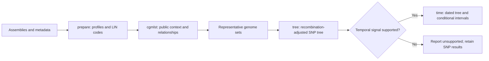

# Klebsiella: from assemblies to a dating decision

For the latest installed-package verification and repeatable allele/SNP examples,
see the [local beta closeout](LOCAL_BETA_CLOSEOUT.md). Its local entry page is
`tmp/beta-local-closeout/index.html`. The runs below remain separate earlier evidence.

Start with the [Mac commands](../mac-klebsiella-walkthrough.md) for your own data.
The recorded example below shows what each stage produces. Its reports and large
input/cache files remain local; they are not bundled with the GitHub checkout.
A fresh clone can run the [small synthetic profile example](USER_WALKTHROUGH.md)
without credentials. That example stops before assembly-based analysis.

## One small native run

The focal isolates are ERR8771929 and ERR8772239, Greek ST258 assemblies with
collection date 2019-05-14. This recorded run used a fresh Apple Silicon Pixi
environment, existing typing references, a frozen provider snapshot and cached
context assemblies. It tests normal module handoffs; it is not a new worldwide
survey or a fresh reference installation.

| Stage | What to inspect | Recorded result |
| --- | --- | --- |
| Prepare | Readiness, exact input IDs, typing and metadata | Both inputs ready; 628/629 loci called each |
| cgMLST | Combined dataset first, nearest relatives, NJ/MDS, geography, selections | 2 inputs + 232 unique public comparisons; explicit LIN8 context within a LIN5 analysis block |
| Selection | Retained inputs, mandatory ties and chosen representatives | 2 inputs + 26 mandatory nearest contexts; a budget can expand to preserve ties |
| Tree | Corrected SNP tree, recombination/callable-site evidence and temporal assessment | Same 28 selected genomes; 100 successful clustered date permutations |
| Time | Supported or unsupported verdict before interpreting dates | Unsupported, p=0.0891; no dated tree, no forced dates |

The profile tree covers the larger pool; the SNP tree covers the selected set.
A nearest relative is defined by the measured distance and jointly compared loci,
not simply membership of a reported LIN group. Public availability and collection
metadata limit geographic conclusions. State-network arrows are inferred changes
on a tree and do not establish transmission or introduction direction.

Host, region and city controls appear only when those fields are reported.
Country, host, region and city use the same state reconstruction and export
component; switching fields changes the observations, not the tree topology.

## A separate supported example

A published-data benchmark uses five alternative 63-genome selections. The
shared 13-genome topology is identical across those selections, and fixed-target
MRCA point estimates span 1.23 years. That span measures selection sensitivity;
it is not a confidence interval or proof of convergence.

A rerun of one saved corrected SNP tree retained all 63 IDs and rooted clades.
Its MRCA is 1995.6604, with a conditional 90% max-posterior region of
1994.268418–1998.078415. This exercises the supported time route separately from
the Greek negative example. It does not rerun SNP-tree construction or demonstrate
that all ST258 groups have temporal signal.

## Open the local reports

The locally generated `tmp/beta-worked-example/index.html` is the single entry
page. It links preparation, the complete cgMLST pool, representative selections,
the polished SNP-tree view, the unsupported time result and the separate supported
example. It links the existing output directories rather than copying distance
matrices or assemblies.

For another machine, run the documented commands on available inputs; the private
local evidence paths are not a downloadable example dataset. Preserve stage
folders together for report links, manifests, downloads and reproducibility.
The compact [recorded-results summary](evidence/recorded-results.json)
and [simulated reviews](SIMULATED_REVIEWS.md) are included in the repository.

## What is accepted and what remains scientific work

See the [current checklist](ACCEPTANCE_PLAN.md). Software correctness, recorded
biological concordance and simulated usability have separate evidence. Dynamic
cluster cutoffs and geographic-origin hypotheses still need independent labelled
cohorts. E. coli/HierCC, x86 and physical SLURM execution are deferred.
